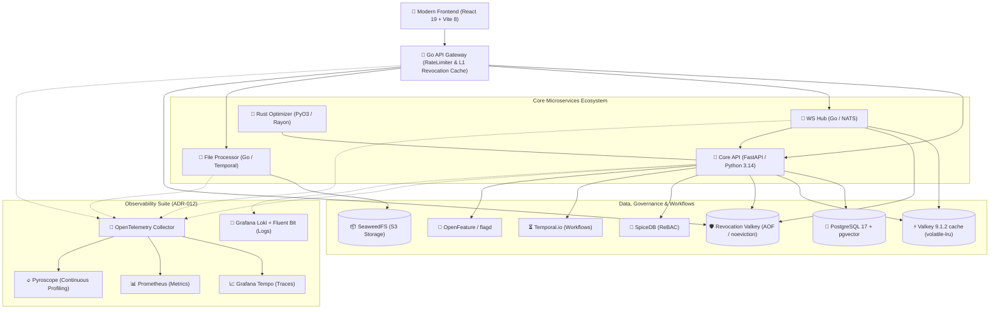
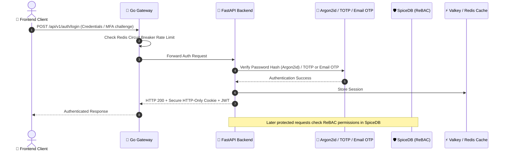
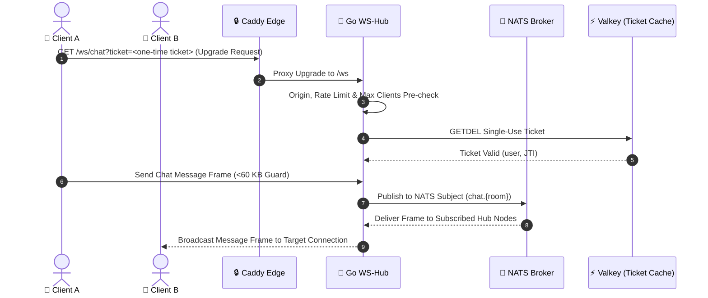

<div align="center">

# 🎓 University Ecosystem Platform
### *The Ultimate Digital Hub for Modern Campus Life*

<p align="center">
  <a href="README.md"><b>English 🇬🇧</b></a> • 
  <a href="README.ru.md"><b>Русский 🇷🇺</b></a>
</p>

[](https://opensource.org/licenses/MIT)
[](https://www.python.org/)
[](quality/quality-contract.json)
[](quality/quality-contract.json)
[](quality/quality-contract.json)
[](quality/quality-contract.json)
[](https://react.dev/)
[](https://vitejs.dev/)
[](https://go.dev/)
[](https://www.postgresql.org/)
[](SECURITY.md)

---

> Coverage badges show policy targets from [`quality/quality-contract.json`](quality/quality-contract.json), not a live certification result. See [current status](docs/superpowers/plans/STATUS.md) for checkpoint evidence and the [quality dashboard](docs/testing/dashboard.md) for its publication state; only a fresh exact-SHA CI/release artifact can certify a build.

**University Ecosystem** is a high-performance, polyglot microservices platform engineered to centralize and revolutionize student interactions. From real-time scheduling and interactive campus navigation to enterprise-grade security and automated workflows, we provide the digital foundation for the next generation of academic excellence.

[Explore Docs](docs/README.md) • [Deployment Guide](docs/DEPLOY.md) • [Testing Guide](TESTING.md) • [Security Policy](SECURITY.md) • [Contributing](docs/CONTRIBUTING.md)

</div>

## 🌟 Visionary Features

> [!IMPORTANT]
> This platform brings together academic services, security controls, and operational tooling in one ecosystem.

- 📅 **Dynamic Academic Engine** – Real-time scheduling powered by a **Rust (PyO3)** native extension using Rayon parallel threads for timetable conflict resolution.
- 💬 **Real-Time Hub** – WebSockets via **Go + NATS**, featuring JWKS hot-reloading, a 60 KB frame cap, and a max-client pre-check.
- 🔒 **Relationship-Based Auth (ReBAC)** – Granular, Zanzibar-inspired permission management powered by **SpiceDB** alongside **OpenFeature** + **flagd** feature flags.
- 🖼️ **Media Intelligence & Workflows** – Asynchronous background processing and image optimization via **Go file-processor**, **Temporal.io**, and S3-compatible **SeaweedFS** storage; the backend can enforce malware scanning through a configured `clamd` service.
- ⚡ **Gateway Session-Revocation Cache** – The local L1 cache stores positive revocation tombstones and uses XFetch probabilistic early refresh to spread Redis rechecks; this reduces synchronized-refresh risk but does not guarantee zero cache stampedes.
- 🗺️ **Vectorized Search & Navigation** – Context-aware semantic search and campus routing leveraging **pgvector** and OpenAI/custom embedding providers.
- 📊 **Full-Spectrum Observability** – End-to-end distributed tracing (**OTEL + Tempo**), metrics (**Prometheus**), profiling (**Pyroscope**), and centralized logs (**Grafana Loki + Fluent Bit**).

## ⚡ Performance & Benchmarks

> The entries below describe source-bound benchmark inputs, load-test thresholds and transfer budgets, not measured release results. Any release performance result needs a dated artifact bound to the exact tested SHA and CI run; see the [performance baseline](docs/testing/performance-regression-baseline.md) and [benchmark workflow](.github/workflows/benchmark.yml).

The checked-in sources define these profiles and limits:

| Subsystem / source profile | Current source contract | What it establishes |
| :--- | :--- | :--- |
| **Schedule conflict solver** | Native batch input is capped at 2,500 items. Criterion fixtures cover 10, 50, 100 and 500 items; the benchmark fixture rejects values above 576. | Input and benchmark-profile limits, not comparative latency. |
| **WebSocket stress profile (ws-hub)** | 10,000 virtual users. With a relaxed upgrade limiter, thresholds are auth errors <1%, p95 connection setup under 2 seconds, more than 50,000 received messages and at least 100 successful upgrades. A default single-IP run expects 429 responses. | Stress-profile checks, not requests-per-second throughput. |
| **Gateway L1 revocation cache** | Positive revocation tombstones only; probabilistic XFetch early refresh requests a live Redis recheck before TTL expiry. | Reduces synchronized recheck risk; it does not guarantee zero cache stampedes. |
| **Frontend transfer budgets** | Main JS raw ≤500 KiB; initial JS gzip ≤420 KiB; initial CSS gzip ≤40 KiB; general lazy JS gzip ≤280 KiB. | Password dictionaries ≤1,250 KiB raw / ≤600 KiB gzip; MapLibre lazy JS gzip ≤286 KiB. These are configured ceilings, not measured bundle sizes. |

## 📂 Project Structure

```text
university_ecosystem/
├── app/               # 🐍 Core API (Python 3.14 / FastAPI) - Business Logic & REST API
├── frontend/          # ⚛️ Modern Web UI (React 19 + Vite 8/Rolldown + Valibot)
├── services/
│   ├── gateway/       # 🚀 API Gateway (Go) - Auth, Rate Limits & L1 Session-Revocation Cache
│   ├── ws-hub/        # 📡 WebSocket Hub (Go/NATS) - Real-time Messaging
│   ├── file-processor/# 📁 Media Engine (Go/Temporal) - Secure Uploads & Processing
│   └── caddy/         # 🔒 Edge Reverse Proxy & TLS Termination
├── native/            # 🦀 Rust Extensions (PyO3/Rayon) - High-Performance Hot Path
├── charts/            # ⎈ Helm Charts (canonical Kubernetes application deployment, ADR-034)
├── k8s/               # ☸️ Kubernetes Manifests, Kyverno Policies & Chaos Mesh
├── alembic/           # 🗄️ Database Migrations (SQLAlchemy 2.0 Async)
└── docs/              # 📖 Architecture Specs & ADRs (see docs/adr/)
```

MVP v1.0.0 targets Docker Compose on one host; Helm remains the canonical
Kubernetes application deployment artifact, outside the MVP deployment path.
See [ADR-054](docs/adr/ADR-054-mvp-docker-compose-deployment-target.md).

## 🧠 Architectural Philosophy

Why the polyglot approach?
- **Python (FastAPI & Python 3.14)**: Selected for development velocity, Dishka dependency injection, rich ecosystem, and async processing for complex business logic.
- **Go (Golang)**: Powers I/O-bound microservices (`gateway`, `ws-hub`, `file-processor`) that provide WebSocket and gRPC services.
- **Rust (PyO3 & Rayon)**: Integrated directly into Python for CPU-heavy hot paths such as timetable conflict resolution and partition management.
- **SpiceDB (ReBAC)**: Implements Zanzibar-inspired relationship-based access control (e.g., *"Student X can view Course Y because they belong to Group Z"*).
- **Vite 8 & Rolldown**: Builds the frontend and applies source-controlled transfer budgets for initial and lazy assets; see the table above.

## 🏗️ Architecture & Core Sequence Flows

### System Topology



### 🔐 Zero-Trust Authentication Sequence



### 📡 Real-Time Chat Sequence



## 🛠️ Technological Stack

| Layer | Technologies | Primary Role | Policy target / current evidence |
| :--- | :--- | :--- | :---: |
| **Frontend** | React 19, Vite 8/Rolldown, Valibot, Framer Motion, TanStack | Matte UX, accessibility (WCAG 2.2 AA), PWA | Policy target: 100%; fresh-SHA evidence required |
| **Backend API** | FastAPI, Python 3.14, Dishka DI, SQLAlchemy 2.0 | Core business logic and REST APIs | Policy target: 100%; fresh-SHA evidence required |
| **Microservices** | Go 1.26, NATS, gRPC, Temporal Go SDK | WebSocket messaging & media orchestration | Policy target: 100%; fresh-SHA evidence required |
| **Native Performance**| Rust, PyO3, Rayon, Maturin | Schedule conflict solver & HMAC | Policy target: 100%; fresh-SHA evidence required |
| **Auth & Security** | Argon2id, SpiceDB, TOTP/email OTP, recovery codes, Kyverno, CSRF nonces | Zero-trust ReBAC, step-up MFA & policy enforcement | Implemented; fresh-SHA evidence required |
| **Data & Cache** | PostgreSQL 17, pgvector, cache Valkey (`volatile-lru`), revocation Valkey (AOF, `noeviction`) | Relational/vector data and isolated durable auth revocation; Gateway L1 caches positive revocation tombstones | Implemented; fresh-SHA evidence required |
| **Observability** | OTEL, Tempo, Prometheus, Pyroscope 2.3.1, Loki + Alloy/Fluent Bit | Distributed tracing, metrics, profiling & log aggregation | Implemented; fresh-SHA evidence required |

## 🚀 Rapid Onboarding

### 1. Secure Environment Setup
Create a local environment from the checked-in example. The bootstrapper generates
development-only secrets when values are missing; never commit `.env` files.
```powershell
Copy-Item .env.example .env
```

### 2. Ignition
Launch the entire ecosystem through the PowerShell 7 bootstrapper. It creates
local secrets, reconciles persistent infrastructure, builds images, and waits
for every runtime and Prometheus target:
```powershell
.\start-docker.ps1 -Build
```

### 🌐 Access Points
- **Digital Hub (Caddy edge, including Frontend SSR)**: [http://localhost](http://localhost)
- **Core API documentation (development only)**: [http://localhost:8000/api/docs](http://localhost:8000/api/docs)
- **Go Gateway Entry**: [http://localhost:8080](http://localhost:8080)
- **Real-Time Signal**: `ws://localhost:8083/ws`
- **Observability Hub**: [Grafana](http://localhost:3000) · [Prometheus](http://localhost:9090) · [Pyroscope](http://localhost:4040)

These HTTP and WebSocket addresses describe the local full-Compose stack; production browser access must use HTTPS/WSS.

## 🛡️ Security & Quality Pillars

- **Multi-factor Auth**: **TOTP**, email OTP and one-time recovery codes alongside **Argon2id** password hashing.
- **Strict Input Validation**: Client-side **Valibot** schemas and gRPC path traversal guards (RZ-27-04).
- **Malware & SSRF Protection**: Configurable `clamd` malware scanning for uploads (enabled and required according to environment configuration) plus strict URL validation blocking internal IP ranges. Verify scanner health before relying on upload acceptance.
- **Zero-Trust Network Policies**: Kubernetes **Kyverno** admission policies and pod security profiles (`RuntimeDefault`).
- **Sanitized Logging**: Automated PII redaction (`_redact_pii`) stripping emails and phone numbers from logs.

## 🧪 Developer Workflow

### **Python (Core API)**
```bash
uv sync --frozen   # Sync Python 3.14 dependencies from the checked-in lock
uv run pytest      # Run the full pytest suite
uv run ruff check app/      # Run Ruff linter
uv run ruff format app/     # Format Python codebase
```

### **React (Frontend)**
```bash
cd frontend
npm ci              # Reproduce the dependency graph from package-lock.json
npm run dev        # Start Vite 8 dev server
npm run lint:knip  # Fail-closed unused files, exports, and dependencies check
npx tsc --noEmit   # Typecheck TypeScript
npm run test       # Run Vitest test suite
```

On Windows, use `npm run lhci` for the full Lighthouse CI collect-and-assert
gate. `npm run lhci:windows` is a measurement-only fallback and does not enforce
LHCI assertions. Dependency installation skips Unix-specific LHCI symlink setup
on Windows; both Windows runners resolve Chromium from Playwright and do not
require symbolic-link privileges.

### **Go (Microservices)**
```bash
cd services/gateway
go test ./...      # Test Go Gateway logic
make test-integration # Run ADR-022 Testcontainers suite
```

## 🔭 Observability & Continuous Monitoring

The platform includes an integrated observability stack:
- **OpenTelemetry & Tempo**: End-to-end distributed tracing across Go microservices and FastAPI.
- **Prometheus**: Gateway L1 revocation-cache counters include `gateway_l1_cache_hits_total` and `gateway_l1_cache_misses_total`.
- **Pyroscope**: Continuous CPU/Memory profiling (`grafana/pyroscope:2.3.1`).
- **Grafana Loki + Fluent Bit**: Structured centralized log aggregation (ADR-012).

---

<div align="center">
  <br />
  <h3>Built with ❤️ by University Ecosystem Engineers</h3>
  © 2026 egorribun • University Ecosystem Platform • Released under the <a href="LICENSE">MIT License</a>.
</div>
