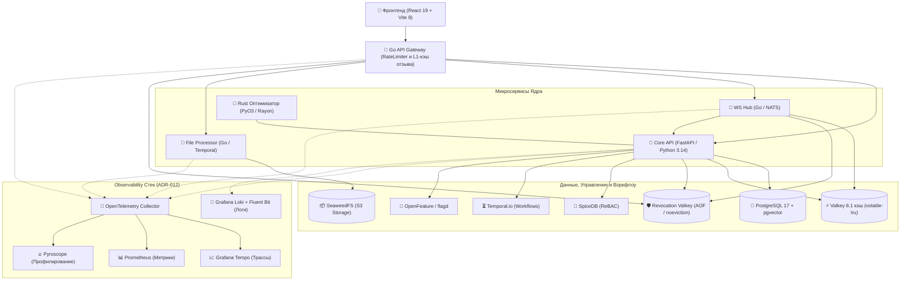
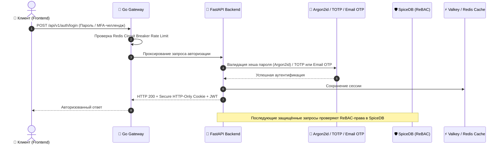
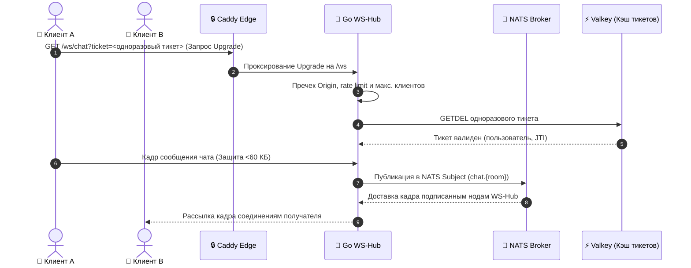

<div align="center">

# 🎓 Платформа Экосистемы Университета
### *Единый цифровой хаб для современного академического пространства*

<p align="center">
  <a href="README.md"><b>English 🇬🇧</b></a> • 
  <a href="README.ru.md"><b>Русский 🇷🇺</b></a>
</p>

[](https://opensource.org/licenses/MIT)
[](https://www.python.org/)
[](quality/quality-contract.json)
[](quality/quality-contract.json)
[](quality/quality-contract.json)
[](quality/quality-contract.json)
[](https://react.dev/)
[](https://vitejs.dev/)
[](https://go.dev/)
[](https://www.postgresql.org/)
[](SECURITY.md)

---

> Бейджи покрытия показывают целевые значения политики из [`quality/quality-contract.json`](quality/quality-contract.json), а не текущую сертификацию. Подтверждения контрольных точек приведены в [текущем статусе](docs/superpowers/plans/STATUS.md), а состояние публикации — в [панели качества](docs/testing/dashboard.md); сборку подтверждает только свежий CI/release-артефакт с точным SHA.

**University Ecosystem** — это высокопроизводительная полиглотная микросервисная платформа, созданная для объединения и автоматизации всех сфер университетской жизни. От расписания в реальном времени и навигации по кемпусу до корпоративной безопасности и автоматических воркфлоу.

[Документация](docs/README.md) • [Инструкция по деплою](docs/DEPLOY.md) • [Тестирование](TESTING.md) • [Безопасность](SECURITY.md) • [Вклад в проект](docs/CONTRIBUTING.md)

</div>

## 🌟 Ключевые возможности

> [!IMPORTANT]
> Платформа объединяет академические сервисы, средства защиты и инструменты эксплуатации в одной экосистеме.

- 📅 **Динамический академический движок** – Расписание пар в реальном времени с параллельным разрешением конфликтов на **Rust (PyO3)** с использованием потоков Rayon.
- 💬 **WebSocket-хаб** – Обмен сообщениями через **Go + NATS** с горячей перезагрузкой JWKS, лимитом 60 КБ на кадр и предварительной проверкой максимального числа клиентов.
- 🔒 **Управление правами на основе отношений (ReBAC)** – Гранулярный доступ на базе **SpiceDB** (Zanzibar architecture) и флаги фичей **OpenFeature** + **flagd**.
- 🖼️ **Медиа-процессинг и воркфлоу** – Асинхронная обработка файлов и оптимизация изображений через **Go file-processor**, **Temporal.io** и S3-совместимое хранилище **SeaweedFS**; бэкенд может требовать проверку загрузок через настроенный сервис `clamd`.
- ⚡ **Кэш отзыва сессий Gateway** – Локальный L1-кэш хранит только положительные tombstone-записи отзыва и с помощью вероятностного раннего обновления XFetch распределяет повторные проверки Redis. Это снижает риск одновременных обновлений, но не гарантирует отсутствие cache stampede.
- 🗺️ **Векторный поиск и навигация** – Семантический поиск по контенту и навигация по кемпусу с использованием **pgvector** и эмбеддингов.
- 📊 **Комплексный мониторинг (Observability)** – Сквозная трассировка (**OTEL + Tempo**), метрики (**Prometheus**), профилирование (**Pyroscope**) и централизованные логи (**Grafana Loki + Fluent Bit**).

## ⚡ Производительность и Бенчмарки

> Ниже описаны привязанные к исходникам размеры benchmark-наборов, пороги нагрузочного профиля и бюджеты передачи; это не измеренные результаты релиза. Любой релизный результат требует датированного артефакта с точным проверенным SHA и CI-запуском; см. [базовую линию производительности](docs/testing/performance-regression-baseline.md) и [workflow бенчмарков](.github/workflows/benchmark.yml).

В исходном коде заданы следующие профили и ограничения:

| Подсистема / профиль | Текущий контракт исходников | Что он подтверждает |
| :--- | :--- | :--- |
| **Поиск конфликтов расписания** | Native batch ограничен 2 500 элементами. Criterion использует наборы из 10, 50, 100 и 500 элементов; fixture отклоняет значения выше 576. | Ограничения входа и профиля, не сравнительную задержку. |
| **Нагрузочный профиль WebSocket (ws-hub)** | 10 000 виртуальных пользователей. При увеличенном лимите upgrade заданы пороги: ошибки авторизации <1%, p95 установки соединения <2 с, более 50 000 полученных сообщений и не менее 100 успешных подключений. Профиль с одним IP ожидает ответы 429. | Нагрузочные проверки, не пропускную способность в запросах/с. |
| **L1-кэш отзыва Gateway** | Только положительные tombstone-записи; вероятностное раннее обновление XFetch вызывает повторную проверку Redis до истечения TTL. | Снижает риск одновременных проверок, но не гарантирует отсутствие cache stampede. |
| **Лимиты передачи frontend** | Основной JS без сжатия ≤500 КиБ; начальный JS gzip ≤420 КиБ; начальный CSS gzip ≤40 КиБ; общий lazy JS gzip ≤280 КиБ. | Словари паролей ≤1 250 КиБ без сжатия / ≤600 КиБ gzip; MapLibre lazy JS gzip ≤286 КиБ. Это настроенные пределы, а не измеренные размеры bundle. |

## 📂 Структура проекта

```text
university_ecosystem/
├── app/               # 🐍 Core API (Python 3.14 / FastAPI) - Бизнес-логика и REST API
├── frontend/          # ⚛️ Современный Web UI (React 19 + Vite 8/Rolldown + Valibot)
├── services/
│   ├── gateway/       # 🚀 API Gateway (Go) - Авторизация, лимиты и L1-кэш отзыва сессий
│   ├── ws-hub/        # 📡 WebSocket Hub (Go/NATS) - Чат и сообщения реального времени
│   ├── file-processor/# 📁 Media Engine (Go/Temporal) - Обработка файлов и медиа
│   └── caddy/         # 🔒 Обратный прокси и TLS терминация
├── native/            # 🦀 Rust-расширения (PyO3/Rayon) - Высокоскоростные вычисления
├── charts/            # ⎈ Helm-чарты (каноничный деплой приложения, ADR-034)
├── k8s/               # ☸️ Манифесты Kubernetes, Kyverno-политики и Chaos Mesh
├── alembic/           # 🗄️ Миграции базы данных (SQLAlchemy 2.0 Async)
└── docs/              # 📖 Архитектура и ADR (см. docs/adr/)
```

## 🧠 Архитектурная философия

Почему полиглотный стек?
- **Python (FastAPI & Python 3.14)**: Обеспечивает высокую скорость разработки бизнес-логики, внедрение зависимостей Dishka DI и богатую экосистему.
- **Go (Golang)**: Реализует I/O-интенсивные микросервисы (`gateway`, `ws-hub`, `file-processor`) с WebSocket- и gRPC-интерфейсами.
- **Rust (PyO3 & Rayon)**: Интегрирован прямо в Python для CPU-intensive задач, таких как расчет конфликтов расписания и управление партициями.
- **SpiceDB (ReBAC)**: Реализует модель Zanzibar (например: *"Студент Х имеет доступ к Курсу Y, так как состоит в Группе Z"*).
- **Vite 8 & Rolldown**: Собирает frontend и применяет заданные в исходном коде лимиты передачи для начальных и отложенных ресурсов; см. таблицу выше.

## 🏗️ Архитектура и Сценарии Взаимодействия

### Топология системы



### 🔐 Сценарий Zero-Trust Аутентификации



### 📡 Сценарий Выборки и Отправки Сообщений в Чат



## 🛠️ Технологический стек

| Слой | Технологии | Роль | Целевой порог / текущие доказательства |
| :--- | :--- | :--- | :---: |
| **Frontend** | React 19, Vite 8/Rolldown, Valibot, Framer Motion, TanStack | Matte UX, доступность (WCAG 2.2 AA), PWA | Цель политики: 100%; нужны свежие SHA-доказательства |
| **Backend API** | FastAPI, Python 3.14, Dishka DI, SQLAlchemy 2.0 | Основная бизнес-логика, REST API | Цель политики: 100%; нужны свежие SHA-доказательства |
| **Микросервисы** | Go 1.26, NATS, gRPC, Temporal Go SDK | WebSocket-обмен сообщениями и обработка медиа | Цель политики: 100%; нужны свежие SHA-доказательства |
| **Производительность**| Rust, PyO3, Rayon, Maturin | Нативное вычисление расписания и HMAC | Цель политики: 100%; нужны свежие SHA-доказательства |
| **Авторизация и безопасность** | Argon2id, SpiceDB, TOTP/email OTP, recovery-коды, Kyverno, CSRF nonces | Zero-Trust ReBAC, step-up MFA и политики | Реализовано; нужны свежие SHA-доказательства |
| **Данные и кэш** | PostgreSQL 17, pgvector, кэш Valkey (`volatile-lru`), revocation Valkey (AOF, `noeviction`) | Реляционные/векторные данные и изолированный отзыв сессий; Gateway L1 хранит только положительные tombstone-записи отзыва | Реализовано; нужны свежие SHA-доказательства |
| **Observability** | OTEL, Tempo, Prometheus, Pyroscope 2.3.1, Loki + Alloy/Fluent Bit | Распределённая трассировка, метрики, профилирование и сбор логов | Реализовано; нужны свежие SHA-доказательства |

## 🚀 Быстрый старт

### 1. Подготовка окружения
Создайте локальное окружение из включённого шаблона. Загрузчик сгенерирует
секреты только для разработки, если значения отсутствуют; `.env` нельзя коммитить.
```powershell
Copy-Item .env.example .env
```

### 2. Запуск
Запуск всей экосистемы через загрузчик PowerShell 7. Скрипт генерирует локальные секреты, настраивает постоянную инфраструктуру, собирает образы и ожидает готовности всех рантаймов и таргетов Prometheus:
```powershell
.\start-docker.ps1 -Build
```

### 🌐 Точки доступа
- **Единый цифровой хаб (Caddy edge, включая Frontend SSR)**: [http://localhost](http://localhost)
- **Документация API (только для разработки)**: [http://localhost:8000/api/docs](http://localhost:8000/api/docs)
- **Вход Go Gateway**: [http://localhost:8080](http://localhost:8080)
- **Real-Time сигнал**: `ws://localhost:8083/ws`
- **Центр наблюдаемости**: [Grafana](http://localhost:3000) · [Prometheus](http://localhost:9090) · [Pyroscope](http://localhost:4040)

HTTP- и WebSocket-адреса выше относятся к локальному full-Compose стеку; в production браузерный трафик должен использовать HTTPS/WSS.

## 🛡️ Безопасность и Стандарты Качества

- **Многофакторная аутентификация**: **TOTP**, email OTP и одноразовые recovery-коды вместе с хешированием паролей **Argon2id**.
- **Строгая валидация**: Схемы **Valibot** на фронтенде и защита от Path Traversal в gRPC.
- **Антивирусная защита и SSRF**: Настраиваемая проверка загрузок через `clamd` (включение и обязательность зависят от окружения) и строгая валидация URL, блокирующая внутренние диапазоны IP. Перед использованием загрузок проверьте доступность сканера.
- **Политики K8s**: Инспекция подов через **Kyverno** и профили `RuntimeDefault`.
- **Очистка персональных данных**: Автоматическая анонимизация PII (почты, телефоны) в логах.

## 🧪 Инструкция для разработчиков

### **Python (Core API)**
```bash
uv sync --frozen   # Загрузка зависимостей Python 3.14 из зафиксированного lock-файла
uv run pytest      # Запуск полной тестовой сюиты
uv run ruff check app/      # Проверка Ruff линтером
uv run ruff format app/     # Форматирование кода
```

### **React (Frontend)**
```bash
cd frontend
npm ci              # Воспроизводимая установка по package-lock.json
npm run lint:knip  # Строгая проверка неиспользуемого кода и зависимостей
npm run dev        # Запуск Vite 8 dev-сервера
npx tsc --noEmit   # Проверка типов TypeScript
npm run test       # Запуск Vitest тестов
```

В Windows используйте `npm run lhci` для полного сбора Lighthouse CI и
проверки всех утверждений. `npm run lhci:windows` — только измерительный
резервный вариант: он не проверяет утверждения LHCI. При установке на Windows
пропускается Unix-настройка LHCI symlink; оба runner используют Chromium из
Playwright и не требуют прав на создание symbolic links.

### **Go (Микросервисы)**
```bash
cd services/gateway
go test ./...      # Запуск модульных тестов Go
make test-integration # Запуск интеграционных тестов ADR-022
```

## 🔭 Наблюдаемость и Мониторинг

Платформа включает интегрированный стек наблюдаемости:
- **OpenTelemetry & Tempo**: Сквозная распределенная трассировка микросервисов Go и FastAPI.
- **Prometheus**: Счётчики L1-кэша отзыва Gateway включают `gateway_l1_cache_hits_total` и `gateway_l1_cache_misses_total`.
- **Pyroscope**: Непрерывное профилирование ресурсов процессора и памяти (`grafana/pyroscope:2.3.1`).
- **Grafana Loki + Fluent Bit**: Централизованный логгирование с анонимизацией персональных данных (ADR-012).

---

<div align="center">
  <br />
  <h3>Сконструировано с ❤️ инженерами University Ecosystem</h3>
  © 2026 egorribun • University Ecosystem Platform • Распространяется по <a href="LICENSE">лицензии MIT</a>.
</div>
